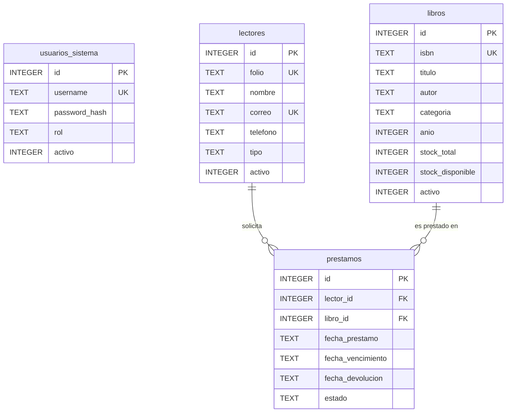

# Sistema de Gestión Bibliotecaria — Opción 1

**Materia:** Tópicos Avanzados de Programación  
**Unidad:** Unidad 1 — Proyecto Final  
**Opción Elegida:** Opción 1. Sistema de Biblioteca  
**Stack Tecnológico:** Python 3.10+, Tkinter / ttk, SQLite 3, hashlib (SHA-256), csv  

---

## 1. Descripción del Proyecto

El **Sistema de Gestión Bibliotecaria** es una aplicación de escritorio diseñada para automatizar y administrar el flujo de operaciones de una biblioteca escolar o universitaria. La plataforma permite controlar el catálogo bibliográfico (libros, autores, categorías y stock disponible), el padrón de lectores (alumnos, docentes y externos), el ciclo de vida del movimiento de préstamos con vigencia y cálculo de vencimientos a 7 días, devoluciones con restitución de inventario, y la generación de reportes especializados de préstamos atrasados con capacidad de exportación a formato CSV. Todo el sistema está respaldado por autenticación basada en roles (`administrador` y `operador`) con contraseñas cifradas en SHA-256.

---

## 2. Requisitos del Sistema

- **Python:** Versión 3.10 o superior (compatible con Python 3.10, 3.11, 3.12, 3.13 y 3.14).
- **Librerías:** Únicamente módulos de la biblioteca estándar de Python:
  - `tkinter` y `ttk` (interfaz gráfica y componentes visuales).
  - `sqlite3` (motor de base de datos relacional embebido).
  - `hashlib` (cifrado criptográfico SHA-256).
  - `csv` (exportación de reportes).
  - `datetime` (cálculo de fechas ISO YYYY-MM-DD y vencimientos).
- Ver archivo [requirements.txt](file:///c:/Users/aldot/OneDrive/Documentos/Programas%20Python/ProyectoUnidad1/requirements.txt).

---

## 3. Instalación y Ejecución Paso a Paso

1. **Clonar o descargar el repositorio:**
   ```bash
   git clone <URL_DEL_REPOSITORIO>
   cd tap-u1-biblioteca
   ```

2. **(Opcional) Crear y activar un entorno virtual:**
   - En Windows (PowerShell):
     ```powershell
     python -m venv .venv
     .\.venv\Scripts\Activate.ps1
     ```

3. **Verificar dependencias:**
   ```bash
   python -m pip install -r requirements.txt
   ```

4. **Ejecutar la aplicación:**
   ```bash
   python main.py
   ```
   *(También es posible ejecutar mediante `python proyecto.py`)*

> **Nota sobre la Base de Datos:** La base de datos `biblioteca.db` se crea automáticamente con todas sus tablas, restricciones de llaves foráneas (`PRAGMA foreign_keys = ON;`) y datos semilla en la primera ejecución (RF-1).

---

## 4. Usuarios y Credenciales de Prueba (A.5)

El sistema cuenta con dos niveles de acceso diferenciados por rol (RF-2). Las contraseñas se almacenan mediante hash SHA-256 (RF-3):

| Usuario | Contraseña | Rol | Permisos y Alcance |
| :--- | :--- | :--- | :--- |
| **admin** | `admin123` | `administrador` | Acceso total: Libros, Lectores, Préstamos, Devoluciones, Reportes y **Gestión de Cuentas del Personal**. |
| **operador** | `operador123` | `operador` | Acceso a operaciones de catálogo, préstamos, devoluciones y reportes. **No puede gestionar cuentas del personal** (RF-2). |
| *inactivo_demo* | *pass123* | *operador* | Cuenta inactiva de prueba (`activo = 0`). El sistema bloquea su ingreso (RF-2, A.4). |

---

## 5. Modelo de Datos Relacional

El esquema relacional fue diseñado en SQLite 3 con integridad referencial activa (`PRAGMA foreign_keys = ON;`):



### Descripción de Tablas:
1. **`usuarios_sistema`**: Cuentas del personal autorizadas para acceder a la aplicación.
2. **`libros` (Entidad A)**: Acervo bibliográfico con control de existencias totales y disponibles para préstamo, además de baja lógica (`activo`).
3. **`lectores` (Entidad B)**: Padrón de usuarios (alumnos, docentes, externos) con estado de habilitación (`activo`).
4. **`prestamos` (Movimiento de Negocio)**: Cruce relacional entre un lector y un libro, con control de fechas ISO, estado (`activo`/`devuelto`) y claves foráneas con restricción `ON DELETE RESTRICT`.

---

## 6. Arquitectura por Capas (RNF-1, RNF-2, A.3)

El proyecto sigue rigurosamente el patrón de arquitectura en capas, separando responsabilidades:

```
ProyectoUnidad1/
│
├── db/                         # Capa de Base de Datos y Conexión
│   ├── __init__.py
│   └── database.py             # Conexión, Foreign Keys ON, esquema DDL y semillas
│
├── models/                     # Capa de Entidades de Dominio (POPO, sin Tkinter)
│   ├── __init__.py
│   ├── usuario.py              # Clase Usuario
│   ├── libro.py                # Clase Libro
│   ├── lector.py               # Clase Lector
│   └── prestamo.py             # Clase Prestamo y DTO PrestamoDetalle (JOIN)
│
├── repositories/               # Capa de Acceso a Datos (SQL puro y mapeo a objetos)
│   ├── __init__.py
│   ├── usuario_repository.py
│   ├── libro_repository.py
│   ├── lector_repository.py
│   └── prestamo_repository.py
│
├── services/                   # Capa de Lógica de Negocio y Reglas del Dominio
│   ├── __init__.py
│   ├── exceptions.py           # Excepciones de negocio y validación
│   ├── auth_service.py         # Login y hash SHA-256
│   ├── usuario_service.py      # Administración de personal
│   ├── libro_service.py        # Validaciones de libros e integridad
│   ├── lector_service.py       # Validaciones de lectores
│   └── prestamo_service.py     # Transacciones de préstamo, devolución y reporte
│
├── ui/                         # Capa de Presentación (Tkinter / ttk puro, sin SQL)
│   ├── __init__.py
│   ├── theme.py                # Gestor de 5 temas y tipografía dinámica
│   ├── login_window.py         # Ventana de autenticación
│   ├── main_window.py          # Ventana principal con menú, pestañas y avatar
│   ├── avatar_widget.py        # Widget interactivo de foto de perfil circular
│   ├── libros_view.py          # Catálogo A (Treeview, buscador, CRUD)
│   ├── lectores_view.py        # Catálogo B (Treeview, buscador, CRUD)
│   ├── prestamos_view.py       # Movimiento con JOIN SQL y cierre
│   ├── reportes_view.py        # Reporte de atrasados y exportación CSV
│   ├── usuarios_view.py        # Administración de cuentas (solo admin)
│   └── dialogs/                # Formularios modales en Toplevel
│       ├── __init__.py
│       ├── libro_dialog.py
│       ├── lector_dialog.py
│       ├── prestamo_dialog.py
│       └── personalizacion_dialog.py # Diálogo de temas y accesibilidad
│
├── avatars/                    # Almacén local de fotos de perfil de usuarios
├── main.py                     # Punto de entrada de la aplicación
├── proyecto.py                 # Acceso compatible alternativo
├── requirements.txt            # Especificación de dependencias (Pillow)
├── .gitignore                  # Exclusión de temporales y bytecode
└── README.md                   # Documentación técnica completa
```

---

## 7. Funcionalidades y Reglas de Negocio Implementadas

1. **CRUD Completo de Libros y Lectores (RF-4):**
   - Altas, consultas con búsqueda en tiempo real, modificaciones y bajas.
2. **Proceso de Negocio: Préstamo (RF-5):**
   - Validación de stock disponible (`stock_disponible > 0`).
   - Validación de estado del lector (no permite préstamo a lectores inactivos).
   - Prevención de duplicidad activa: Un lector no puede tener dos préstamos activos del mismo libro simultáneamente.
   - Transacción atómica: Se descuenta 1 ejemplar de `stock_disponible` y se calcula la fecha límite a 7 días en formato ISO (`YYYY-MM-DD`).
3. **Cierre de Movimiento: Devolución:**
   - Registra la fecha de devolución, cambia el estado a `devuelto` y restituye +1 al `stock_disponible` del libro (sin exceder el total).
4. **Consulta con JOIN SQL (RF-7):**
   - Cruce en pantalla entre `prestamos`, `lectores` y `libros` mostrando nombres, folios, títulos, ISBN y estados.
5. **Reporte del Caso Problemático (RF-8):**
   - Detección automática de préstamos con estado `activo` cuya fecha de vencimiento es menor a la fecha actual (`vencimiento < date('now')`).
6. **Manejo Robusto de Integridad y Excepciones (RF-10, RNF-4):**
   - No se permite eliminar libros o lectores con préstamos activos.
   - Si un registro tiene historial cerrado, se aplica desactivación (baja lógica) para proteger la integridad referencial.
   - Confirmaciones con diálogo `messagebox.askyesno` antes de cualquier acción irreversible (RF-9).
7. **Personalización Visual y Accesibilidad (Nuevas Características):**
   - **Gestor de Temas (5 Modos de Color):**
     - 🏛 *Modo Estándar:* Azul marino institucional sobre gris pizarra.
     - 🌙 *Modo Oscuro / Nocturno:* Fondos grafito/negro con textos blancos y azul neón para descanso visual.
     - 🌸 *Modo Pastel:* Tonos suaves crema, lavanda y verde menta relajante.
     - 💼 *Modo Vivo / Corporativo:* Combinación elegante de azul rey, blanco puro y acentos.
     - 🌲 *Modo Bosque:* Tonos verde oliva, beige y café tierra.
   - **Accesibilidad Tipográfica:**
     - Cambio de familia tipográfica (`Segoe UI`, `Arial`, `Consolas`, `Verdana`, `Trebuchet MS`).
     - Escalador de tamaño de fuente (9pt, 10pt, 12pt, 14pt) para usuarios con requerimientos visuales.
   - **Fotos de Perfil de Usuario (Avatar Circular):**
     - En el encabezado superior derecho se muestra el avatar interactivo del usuario.
     - Permite hacer clic y seleccionar cualquier imagen (.png, .jpg, .jpeg) desde la computadora.
     - La imagen se reescala y recorta en círculo perfecto con Pillow, guardando la ruta y persistiendo en `usuarios_sistema`.
   - **Persistencia Total:**
     - El tema, fuente, tamaño y foto de perfil se guardan en la base de datos SQLite y se restauran automáticamente en cada inicio de sesión.
8. **Extras Opcionales (A.6):**
   - Exportación del reporte de atrasados a archivo CSV estándar.
   - Interfaz gráfica moderna con estilos y transiciones ttk.

---

## 8. Preguntas de Defensa (Sección 5 de la Rúbrica)

### 1. ¿Dónde vive la regla de negocio y por qué no está en el botón?
> **Respuesta:** La regla de negocio vive exclusivamente en la capa de servicios (`services/`), por ejemplo en `PrestamoService`, `LibroService` o `LectorService`. No reside en los controladores de eventos de los botones de la UI para garantizar el principio de separación de responsabilidades (RNF-2), permitir que la lógica sea 100% reutilizable y testeable de forma automatizada o por consola, y evitar acoplar la integridad de los datos a los widgets gráficos de Tkinter.

### 2. Muestre el JOIN y explique cada tabla.
> **Respuesta:** La consulta con JOIN reside en `PrestamoRepository.listar_con_detalle()` y se ejecuta de la siguiente manera:
```sql
SELECT 
    p.id,
    p.lector_id,
    lec.folio AS lector_folio,
    lec.nombre AS lector_nombre,
    lec.tipo AS lector_tipo,
    p.libro_id,
    lib.isbn AS libro_isbn,
    lib.titulo AS libro_titulo,
    p.fecha_prestamo,
    p.fecha_vencimiento,
    p.fecha_devolucion,
    p.estado
FROM prestamos p
JOIN lectores lec ON p.lector_id = lec.id
JOIN libros lib ON p.libro_id = lib.id
ORDER BY p.id DESC;
```
- **`prestamos p`**: Tabla principal de movimientos que contiene las llaves foráneas (`lector_id`, `libro_id`), las fechas del proceso y el estado (`activo`/`devuelto`).
- **`lectores lec`**: Tabla padre vinculada mediante `p.lector_id = lec.id`, aportando el nombre completo, folio y tipo de usuario.
- **`libros lib`**: Tabla padre vinculada mediante `p.libro_id = lib.id`, aportando el título de la obra y su código ISBN.

### 3. ¿Qué pasa si intentan un movimiento que viola stock, cupo u horario?
> **Respuesta:** El servicio (`PrestamoService`) evalúa la condición antes de realizar cualquier operación en la base de datos. Si el stock disponible es menor o igual a 0, lanza una excepción controlada de tipo `BusinessError("No hay stock disponible para este libro")`. La vista captura esta excepción sin colapsar la aplicación (RNF-4) y presenta una alerta explicativa al usuario mediante `messagebox.showerror`.

### 4. ¿Por qué desactivar en lugar de DELETE?
> **Respuesta:** Porque en una base de datos relacional con `PRAGMA foreign_keys = ON;`, eliminar físicamente un registro padre (libro o lector) con movimientos históricos asociados violaría la restricción de integridad referencial (`ON DELETE RESTRICT`) o borraría en cascada la trazabilidad de auditoría de la biblioteca. La baja lógica (`activo = 0`) preserva el historial de transacciones pasadas impidiendo que el registro sea seleccionado para nuevos préstamos.

### 5. Si mañana cambian SQLite por PostgreSQL, ¿qué archivos tocarían?
> **Respuesta:** Gracias al desacoplamiento de la arquitectura por capas, únicamente se modificarían:
1. `db/database.py`: Para cambiar el motor de conexión (`sqlite3.connect` por `psycopg2.connect`) y la sintaxis de inicialización de tablas.
2. Los archivos en `repositories/` (`usuario_repository.py`, `libro_repository.py`, etc.): Únicamente para adaptar particularidades de SQL o placeholders (por ejemplo, `%s` en PostgreSQL en lugar de `?`).
> **No se tocaría ninguna línea de código en `models/`, `services/`, ni en la capa visual `ui/`.**
